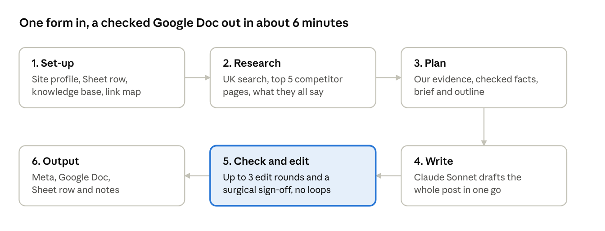

# Habib's Autoloader

**A multi-project SEO blog writer for n8n.** Fill in a short form; about 6 minutes later a researched, fact-checked, on-brand blog post is waiting in Google Docs, with its meta data, schema and review notes logged in a Google Sheet. One workflow serves up to five websites, each with its own brand, market, facts and house style.



## What it does

- **Researches what already ranks.** A live web search in the project's own market finds the top pages and "People also ask" questions, then reads the top 5 competitors.
- **Adds what competitors can't.** It separates what every ranking page already says (covered briefly) from first-hand detail pulled from your own case studies, service pages and knowledge base, aiming for 20 to 35% genuinely new information.
- **Never invents facts.** Every first-hand point must quote its source word for word, or it is dropped before writing. Quotes, figures and company practices not in your sources are flagged.
- **Writes like an expert, not a machine.** It answers first, uses short question headings with a bold answer under each, and makes every paragraph add something. Weak hedges, filler and AI-sounding words are banned and checked in code.
- **Checks and fixes itself, without looping.** Up to three check-and-edit rounds run, then a surgical sign-off pass that may only touch flagged sentences, with a code guard that throws away any edit that rewrites too much.
- **SEO-ready output.** It handles keyword placement and density, 5 to 8 allow-listed internal links, verified external links, a 140 to 155 character meta description chosen from three drafts, an FAQ section, and Article plus FAQPage JSON-LD.
- **Built for several brands.** Each project sets its own market (country, Google domain, UK or US spelling, currency), acronyms, terminology swaps, claim rules, heading case and pricing policy.
- **Cheap to run.** Claude Sonnet only writes and edits; a low-cost model plans and audits; code does most of the checking for free. A typical post costs about $0.50 to $1 in AI fees.

Full walkthrough, node by node: [docs/how-it-works.md](docs/how-it-works.md).

## Tech

n8n (Form trigger, Code nodes, LangChain LLM chains with structured output parsers), OpenRouter (Claude Sonnet for writing, Grok for planning and audits, Perplexity Sonar for live search), Google Drive and Docs, Google Sheets.

## Repository

| Path | What it is |
| --- | --- |
| `workflow/habibs-autoloader.json` | The workflow. Import it into n8n. |
| `projects/_template/` | Blank knowledge base and link map to copy for each of your projects. |
| `projects/northwind-solar/` | A complete example project (a fictional solar installer). |
| `docs/how-it-works.md` | Every stage and node, cost per post, editing time and the Project settings reference. |
| `build/` | The source: prompts (`prompts.py`), Code-node JavaScript (`js_code.py`, `js_v3.py`), the builder (`build.py`) and the tests (`make_test.py`). |
| `tools/` | Make a shareable copy of your own export, check a run's token use, scan for secrets before pushing. |

## Set it up

1. **Import** `workflow/habibs-autoloader.json` into n8n.
2. **Credentials:** create an OpenRouter key (one key covers all three models), a Google Drive OAuth credential and a Google Sheets OAuth credential, and pick them on the nodes that show a warning.
3. **Google Sheet:** add these headers to row 1: `Request ID | Date | Project | SEO name | Title | Main keyword | Note from SEO | Status | Blog file | Word count | Meta title | Meta description | Slug | Notes | Info gain %`. Columns are matched by name, so the order is up to you.
4. **For each project (up to 5):**
   - copy `projects/_template/`, fill in the knowledge base and link map, and upload both to Google Drive **as plain files** (not converted to Google Docs);
   - open the **Project** node, fill in that project's settings, paste the two Drive file IDs and set `enabled: true`;
   - make the form's **Project** dropdown option match the project's `name`.
5. **Config** node: paste the Sheet URL and the Drive folder ID for finished Docs. Paste the Sheet URL into **Mark Failed** too.
6. In **Settings > Error workflow**, pick this same workflow so failed runs are marked in the Sheet.
7. Run one test from the form, then **Publish** and share the form's production URL with your writers.

## Change it

Small changes (a prompt line, a banned word) can be made directly in n8n. For bigger ones, edit the source in `build/` and rebuild:

```bash
cd build
python build.py ../workflow/habibs-autoloader.json
python make_test.py
```

`make_test.py` writes `test.html`, which runs the Code nodes against the example project in a browser: serve the folder with `python -m http.server 8765` and open `http://127.0.0.1:8765/test.html`. Every line should say PASS.

## Before sharing your own copy

Your export from n8n contains your Sheet, Drive and credential IDs. Run it through `python tools/sanitize_workflow.py export.json shareable.json` and check `python tools/scan_secrets.py` before pushing anything.
