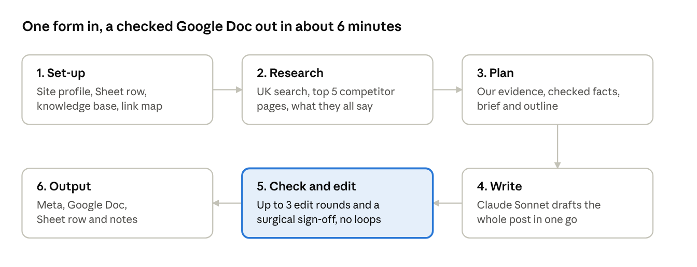

# How Habib's Autoloader works

A writer fills in a form; about 6 minutes later a researched, fact-checked post sits in Google Docs and a Sheet row holds its meta data and anything a human still needs to check.

Stage 1 is plain code. The later stages mix AI steps with code checks; only 13 of the 60 working nodes call an AI model.

## Stage 1: set-up

1. **Blog Request Form** receives the request.
2. **Config** holds the Sheet link and the Google Drive folder for finished Docs.
3. **Start** tidies the form answers.
4. **Project** looks up the chosen project: brand, domain, sitemap, market (country, Google domain, language, spelling, currency), author, categories, heading case, case studies, acronyms, terminology, claim rules and Drive file IDs. Every later step reads these from here, so nothing is hard-coded to one site. It stops with a clear message if the project is disabled or its files are missing.
5. **Post Settings** turns the format (Standard guide, Listicle, How-to steps, Comparison) and the case-study choice into structure rules shared by the planner, writer and editors.
6. **Reference Page** reads an optional competitor page to beat.
7. **Find Sheet Table**, **Build Request Row**, **Add Request Row** log the request as "Writing", matching Sheet columns by name.
8. **Download Knowledge Base** and **Knowledge Base** load the project's facts, proof and rules (cleaning up rich-text paste artefacts). **Download Link Map** loads the pages it may link to.

## Stage 2: research

1. **Web Search** asks Perplexity Sonar to search like a user in the project's market and return the 10 pages most likely to rank, "People also ask" questions and related searches.
2. **Pick Competitors** keeps the top 5 real articles, skipping forums, social media and all of your own projects' sites.
3. **Fetch Page** and **Competitor Digest** reduce each page to its headings, main text and length.
4. **Commodity Audit** (Grok) lists what those pages say; **Score Commodity** marks anything said by two or more as commodity (cover briefly, never the differentiator) and finds questions nobody answers well.

## Stage 3: first-hand evidence and planning

1. **Fetch Sitemap Index**, **Sitemap Files**, **Fetch Sitemaps** read the project's sitemap.
2. **Pick Own Pages** picks the case studies and service pages that match the keyword. Words that appear in most of the site's addresses (its city, its trade) are ignored automatically, and the project's optional topic synonyms widen the match.
3. **Fetch Own Pages** and **Own Evidence** turn them into tagged evidence (E1, E2...).
4. **Gain Planner** (Grok) plans intent, expected subtopics, reader questions, supporting keywords, the H1, the opening answer and 5 to 8 "information gain" points, each with a word-for-word quote from its source.
5. **Verify Gain** checks every quote really exists in its source. Anything it can't find is dropped before writing and listed in the Doc.
6. **Brief**, **Outline Planner** (Grok) and **Validate Outline** produce a section-by-section outline; the code enforces allow-listed links (5 to 8 internal, homepage in the intro, a contact link in the closing), checks external links load, and scales word counts to the target.

## Stage 4: writing

**Blog Writer** (Claude Sonnet) writes the whole post in one call. Its rules:

- Answer first: the opening answers the title in two sentences, with the primary keyword.
- Every paragraph adds a fact, explanation, example or action; no filler transitions or vague claims.
- Guidance first, case study second (2 to 4 sentences, under 15% of the post).
- Confident wording: no "may", "might", "make sense", intensifiers or placeholder words.
- Facts only from the knowledge base or evidence; competitor topics written as what to ask a supplier.
- Short question headings with a bold answer under each, H3s so no stretch runs over 300 words, up to three lists.
- Links inside useful sentences, never "Read more on..." prompts.
- The project's language, currency, acronyms, terminology, heading case and pricing rule.

## Stage 5: checking and editing

Up to four check-and-fix rounds. None loops back, so every run finishes.

| Round | Checks | Edit | Runs when |
| --- | --- | --- | --- |
| 1 | QA Check, Gain Auditor, Gain Score | Editor | any issue |
| 2 | Recheck QA, Recheck Gain Auditor, Recheck Gain Score | Editor 2 | issues left |
| 3 | Final QA, Final Gain Auditor, Final Gain Score | Surgical Editor | a fixable issue left |
| Sign-off | Sign-off QA, Sign-off Gain Auditor, Sign-off Gain Score | none | after a surgical edit |

- **QA (code, free):** links, keyword placement and density, supporting keywords, banned words, link prompts, scene openings, heading length and case, section and paragraph length, lists, bold openers, invented quotes, the project's acronyms, terminology, claim rules and spelling, price rules in the project's currency, word count and readability. Safe fixes (dashes, terminology, Title Case headings, bad links) are made in code.
- **Gain audit (Grok, then code):** labels each paragraph as new information, commodity, mixed or filler, checks it helps answer the title, and lists missing topics and questions.
- **Surgical sign-off:** the last editor may only change the sentences an issue points to. If fewer than 75% of sentences come back unchanged, or the length moves by more than 15%, the edit is discarded.

## Stage 6: output

1. **Meta Generator** (Grok) writes the slug, meta title, category and three meta descriptions; **Build Doc Upload** keeps the one that is 140 to 155 characters, uses the keyword and leaves out the brand.
2. The Doc gets an SEO details table, the evidence list with sources, review notes, ready-to-paste JSON-LD (Article and FAQPage), a TL;DR box and the post.
3. **Create Google Doc**, **Share: Anyone Can Edit** and **Mark Done** publish it and update the Sheet: "Done", or "Done - check notes" with each open issue.
4. **On Failure** and **Mark Failed** log a failed production run in the Sheet.

## Cost, speed and editing time

Measured on a real 1,200-word run that went through every editing round (close to the most a run uses):

| Model | Calls | Tokens in | Tokens out |
| --- | --- | --- | --- |
| Claude Sonnet (writer, editors) | 4 | about 67,000 | about 23,000 |
| Grok (planning, audits, meta) | 9 | about 50,000 | about 18,000 |
| Perplexity Sonar (web search) | 1 | under 1,000 | under 1,000 |

At about $3 per million tokens in and $15 per million out, that is roughly $1 a post; a clean post skips the edits and costs about half. It took 6 minutes 12 seconds. Check current prices on OpenRouter; `tools/run_usage.py` prints the tokens for any run.

Cost stays low because the expensive model only writes and edits, code does most of the checking for free, edits run only when needed, nothing loops, inputs are capped (5 competitor pages, a few of your own) and unverifiable facts are dropped before writing.

In testing, finished posts carried 0 or 1 open notes. A human review (read the notes, spot-check facts against the evidence list, read once for tone, check links) takes roughly 15 to 30 minutes per post.

## Project settings reference (Project node)

| Setting | What it does |
| --- | --- |
| `enabled` | Only enabled projects can be chosen. |
| `name` | The brand, written into posts; must match the form's Project option. |
| `domain`, `base_url`, `sitemap_url` | Your site. The sitemap defaults to `/sitemap_index.xml`. |
| `description`, `search_context` | What the business is; tells the planner and the web search which meaning of a keyword fits. |
| `home_anchor` | Link text for the homepage link. |
| `author` | Person for the Article schema, or `null` for the brand. |
| `categories` | Blog categories the meta step may choose from. |
| `case_studies` | Whether the site publishes case studies. |
| `heading_case` | `sentence`, `title` (every heading) or `title_h1` (H1 only). |
| `prices_on_request` | `true`: posts never state your own prices, only general market ranges. |
| `quote_details` | What readers should send for a quote. |
| `market` | Country, search label, Google domain, language, `british`/`american` spelling, currency and symbol. |
| `acronyms` | Written exactly like this; other capitalisations are flagged. |
| `terminology` | `[avoid, use]` pairs, swapped automatically. |
| `word_preferences` | Extra vocabulary guidance for the writer. |
| `claim_rules` | `[regex, flags, message]`: anything matching is flagged for the editor. |
| `topic_synonyms` | Optional `[trigger, core words, related words]` groups for finding your own pages. |
| `sources_hint` | Kinds of external sites worth citing. |
| `kb_file_id`, `link_map_file_id` | Drive IDs of the project's knowledge base and link map. |
